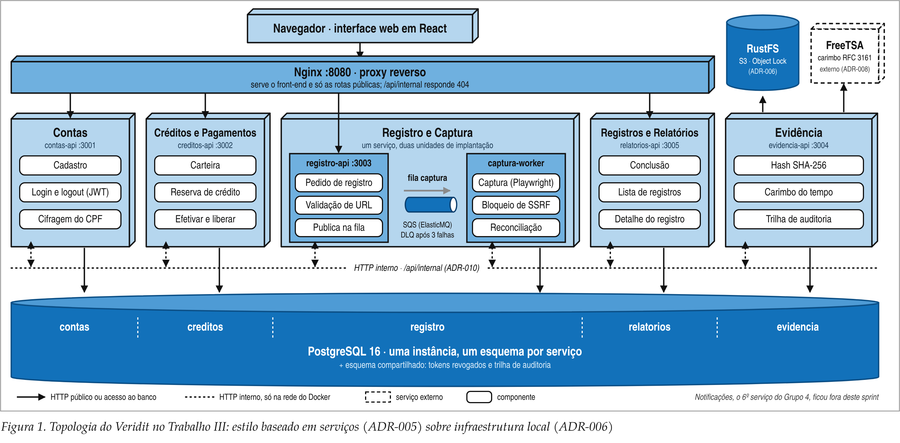

# Veridit — Trabalho III (MATA62, Engenharia de Software I, UFBA)

Implementação de parte dos requisitos do **Veridit**, plataforma de registro de conteúdo da internet com valor de prova, seguindo a **arquitetura baseada em serviços** definida no Trabalho II pelo Grupo 4.

- **Arquitetura de origem:** repositório [g-barreto00/MATA62-T2](https://github.com/g-barreto00/MATA62-T2) (do qual este é um fork) e o [documento arquitetural do T2](docs/arquitetura/Documento_Arquitetural_T2_Grupo4.pdf), de Daniel Santana, Davi Guimarães, Gabriel Barreto e Leone Vicentine.
- **Os arquivos do Grupo 4** (`ADR's.md`, `carac_arq.md`, `comp_cand.md`, `diag_comp.md`, `diag_mod.md`) ficam na raiz como vieram; em `ADR's.md` só foi acrescentado, ao final, o status de cada ADR depois do T3.
- **Desvios da arquitetura:** acordados com o Grupo 4 em 10/11/2026 (Issue #1) e registrados nas [ADRs 006 a 010](docs/adr/README.md).

## Equipe do T3

| Papel | Integrante |
|---|---|
| A — Contas + Créditos | Davi Araújo |
| B — Registro e Captura | Guilherme Loiola |
| C — Evidência | Pedro Azevedo |
| D — Registros e Relatórios + Web | João Ferraz |
| E — Infraestrutura, integração, documentação e arquitetura | Cauã Marinho |

## Como rodar

**Pré-requisitos:** Docker Desktop (com Docker Compose) e, para desenvolver fora do Docker, Node.js 22.

```bash
cp .env.example .env
docker compose up --build
```

| O quê | Onde |
|---|---|
| Interface (pelo Nginx) | <http://localhost:8080> |
| Health dos serviços | <http://localhost:3001/api/health> (contas) · 3002 (créditos) · 3003 (registro) · 3004 (evidência) · 3005 (relatórios) |
| RustFS (console das evidências; login com `S3_ACCESS_KEY` e `S3_SECRET_KEY`) | <http://localhost:9001> |
| Mailpit (e-mails enviados) | <http://localhost:8025> |
| ElasticMQ (estatísticas da fila) | <http://localhost:9325> |

Mais capacidade de captura: `docker compose up --scale captura-worker=3`.

### Desenvolvendo um serviço fora do Docker

```bash
npm install
docker compose up postgres elasticmq rustfs s3-init mailpit   # só a infraestrutura
npm run start:dev -- contas-api                                   # o serviço em que você está trabalhando
npm test
```

Front em React (`web/`), com recarga instantânea:

```bash
cd web && npm install
npm run dev        # http://localhost:5173, falando com o back pelo Nginx (docker compose up)
npm run dev:mock   # sem back nenhum: API falsa em memória, para trabalhar nas telas
```

Fora do Docker, troque nos endereços do `.env` os nomes `postgres`, `elasticmq`, `rustfs`, `mailpit` e `*-api` por `localhost` (com as portas da tabela acima).

## Arquitetura



Estilo baseado em serviços (ADR-005 do Grupo 4) rodando na infraestrutura local da [ADR-006](docs/adr/ADR-006-infraestrutura-local.md). A figura é gerada por `python3 docs/arquitetura/gerar-topologia.py docs/arquitetura/topologia-t3.svg`.

## Estrutura

```
apps/
  contas-api/       Serviço Contas (01 Cadastro, 02 Acesso e Sessão)
  creditos-api/     Serviço Créditos e Pagamentos (07 Controle de Créditos)
  registro-api/     Serviço Registro e Captura (09 Solicitação de Registro)
  captura-worker/   Serviço Registro e Captura (10 Captura), consome a fila
  evidencia-api/    Serviço Evidência (11 a 14, interno)
  relatorios-api/   Serviço Registros e Relatórios (15 Conclusão, 18 Consulta)
web/                Front em React + Vite + Tailwind (servido pelo Nginx)
libs/
  compartilhado/    autorização, auditoria, erros de domínio, health
  infra/            adaptadores: ElasticMQ/SQS, RustFS/S3, SMTP, RFC 3161, PostgreSQL
infra/              configuração do ElasticMQ e do Nginx
docs/               ADRs do T3, contratos, requisitos, SOLID e o documento do T2
```

## Como trabalhamos no Git

- A `main` é protegida: entra só por pull request com 1 aprovação.
- Uma branch por frente de trabalho: `feature/contas`, `feature/creditos`, `feature/captura`, `feature/evidencia`, `feature/relatorios`, `feature/web`, `feature/infra`.
- Mudou um contrato entre serviços? Atualize `docs/contratos.md` no mesmo pull request.
- Precisa mudar a arquitetura? Anote em `docs/desvios-pendentes.md`, combine com o Grupo 4 e registre uma ADR nova em `docs/adr/`.

## Documentos

- [Contratos entre os serviços](docs/contratos.md)
- [Requisitos implementados](docs/requisitos-implementados.md): 7 de 16 (44%)
- [ADRs do T3 (desvios da arquitetura)](docs/adr/README.md) e [resumo dos desvios](docs/desvios-pendentes.md)
- [Princípios SOLID, onde e por quê](docs/SOLID.md)
- [Divergências entre o protótipo de telas e o front](docs/design-divergencias.md)

## Estado atual

O fluxo completo de um registro de tela funciona de ponta a ponta:

1. Cadastro de advogado ou usuário comum, com 5 créditos iniciais (REQ01).
2. Login e logout com JWT, recusado em todos os serviços depois do logout (REQ03, REQ04).
3. Pedido de registro de uma URL: reserva 1 crédito e entra na fila (REQ08).
4. O worker captura a página (screenshot e HAR), a evidência é selada (SHA-256, manifesto, carimbo RFC 3161 da FreeTSA, RustFS com Object Lock) e o registro é concluído, efetivando o crédito (REQ11).
5. Lista e detalhe dos registros do usuário, com hashes, carimbo e arquivos (REQ12, REQ13).

Se a captura falhar 3 vezes, a mensagem vai para a DLQ e o crédito volta para o usuário. Ficaram fora deste sprint: compra de créditos e pagamento, e-mails, recuperação de senha, vídeo, PDF e zip (ver [requisitos implementados](docs/requisitos-implementados.md)).
